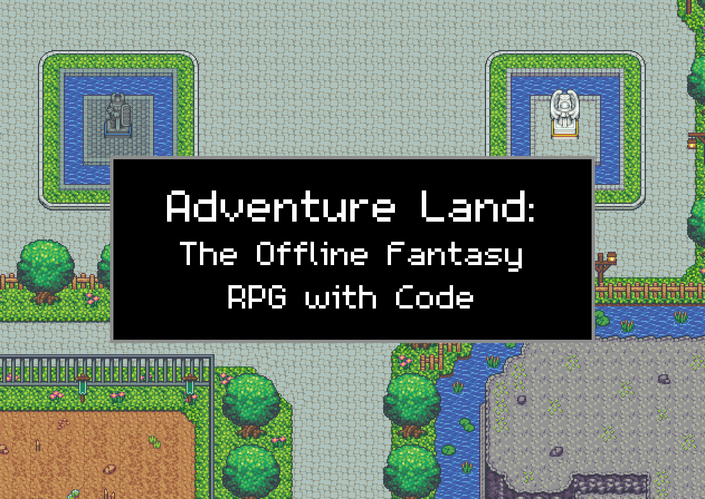

# Adventure Land: The Offline Fantasy RPG with Code

**The MMORPG you play by writing code, now on your own PC with no other players, no account and nothing to buy.**

[Thanks](#thanks-and-accreditation) · [What it is](#what-it-is) · [Install and play](#what-you-need-to-install) · [Settings](#settings) · [What changed](#changes-from-the-original-game) · [License](#license)

---

## Thanks and accreditation

This game exists because of **[Adventure Land](https://adventure.land)**, created by **Kaan Soral**. Every map, monster, class, item, sound and line of game code that makes this game what it is came from him and the Adventure Land team. Kaan open-sourced the game, and when asked about this project he gave his blessing to release it as a sub-game of Adventure Land, with the name **Adventure Land: The Offline Fantasy RPG with Code**, and said its assets are covered by Adventure Land's. Thank you, Kaan.

- **Kaan Soral and the Adventure Land developers:** the original game, its engine and its source code: [adventureland_mongodb](https://github.com/kaansoral/adventureland_mongodb), the MongoDB port this game is built on.
- **Ellian**, Adventure Land's pixel artist, and the other artists, composers and developers whose libraries, assets and work Adventure Land is built from. Their art and music are what you see and hear in this game.
- **Mark Jayson Lacandula (Json)**, one of Adventure Land's first players, who went on to make all of its maps, extend its tilesets and sprites, and learn pixel art along the way.
- **Adventure Land's players and community**, on Steam and on [/r/mmorpg](https://www.reddit.com/r/mmorpg/), who tested, gave feedback and kept the game going for years.
- **Steam** and **Google Cloud**, who Kaan thanks for helping Adventure Land reach its players.
- **[Anthropic's Claude](https://claude.ai/code)**, the AI coding assistant that helped write this offline version, working from the requests and testing of the project's owner. See [Made with AI](#made-with-ai).

Adventure Land is used under the **Adventure Land Only Use** license ([LICENSE](LICENSE)): attribution is required, with a link back to [adventure.land](https://adventure.land). This project is an unofficial derivative and is not the online game. To play Adventure Land online, with other players, go to **[adventure.land](https://adventure.land)**.

## What it is

**Adventure Land: The Offline Fantasy RPG with Code** is an offline, single-player version of Adventure Land, the MMORPG you can play by writing code. It runs entirely on your own Windows PC. There are no other players, no account to sign up for, and nothing to buy.

- **Play by hand or by code.** Use the mouse and keyboard like any other RPG, or write small JavaScript programs (CODE) that play your characters for you.
- **Up to 100 characters,** several of them online and in their own windows at the same time.
- **A Mod Menu and a settings file** to tune the game: XP, drops, prices, damage, holiday events and more.
- **Party AIO and Bank Items List,** two ready-made scripts for running a whole party and sorting your bank.
- **A Player and Coding Guide** that takes you from installing the game to writing your own scripts.
- **No setup puzzles:** double-click `Adventure Land.exe`. It starts the database, website and game server for you and opens the game.

## Made with AI

This offline version was built with the help of AI. The changes in this version of the game (the Mod Menu and its settings, the single-player changes, the screen layout, the Party AIO script and the packaging) were written with Anthropic's Claude as a coding assistant, working from the requests and testing of the project's owner.

The new artwork is AI-generated too: the redrawn monsters, the redesigned town NPCs, the new character looks and the title screen art. It is used alongside the original Adventure Land art, which was made by the Adventure Land artists and is unchanged where it hasn't been replaced.

## What you need to install

Install these once:

1. **Node.js** (the LTS version) from https://nodejs.org. Keep the default options. It runs the game's website and game server.
2. **MongoDB Community Server** from https://www.mongodb.com/try/download/community. Choose "Complete" and keep the default options. MongoDB Compass is optional. This is the database that saves your characters, items and settings.
3. **Microsoft Edge.** It comes with Windows. The game window uses WebView2, the browser engine that comes with Edge and Windows 11, so there is nothing extra to install on most PCs.

Git isn't needed, because the shared engine already comes in the game folder.

## Playing

1. Extract the zip somewhere, for example `C:\AdventureLand`. Use a new, empty folder each time rather than unzipping over an older copy.
2. Double-click **`Adventure Land.exe`**.

A small window shows the progress while it starts the database, the website and the game server, with no console windows. Then the game opens in its own window. It opens on the title screen: press Login (or Enter) to go to character select. The very first start also installs the game's packages and loads the maps, so it takes a few minutes. After that it's quick.

On character select, click a Free Slot (or New) to create a character, then click a character to play. Every class has 4 extra starting looks, Opt. E to H. The Logout button at the top left of the Settings window takes you back to the title screen.

You're logged in automatically. Everything stays on your PC, and only your PC can connect to the game.

The first time you run `Adventure Land.exe`, Windows may show "Windows protected your PC", because the file isn't digitally signed. Click "More info", then "Run anyway". Windows only asks once.

## Stopping

Just close the game window. Adventure Land.exe shows "Saving your characters..." while it waits for your characters to save and stops everything, then closes by itself. If you have several character windows open, it waits until you close the last one.

Don't end the game's processes in Task Manager, so your characters get a chance to save.

## Play.bat and Stop.bat

These do the same job as `Adventure Land.exe` with console windows you can see, which helps when something goes wrong:

- **`Play.bat`** starts everything in order and opens the game.
- **`Stop.bat`** closes the game window, waits a few seconds so your characters save, then stops the game server, the website and the database. Always use it rather than just closing the console windows, so the database shuts down cleanly.

When the game is started with `Adventure Land.exe`, the database, website and game server write their messages to the `logs` folder instead.

## Settings

The easiest way is the **Mod Menu**: the computer button at the bottom of the screen, left of the game log. It opens on a list of groups (Combat, Monsters, Loot, Crafting & Gathering, Market, Characters and Holiday Events), each showing how many of its settings you've changed; click one to see its settings. Changes apply as soon as you set them, and your choices are saved to `settings.txt`. Type a number and press Enter, or click ON/OFF. Two settings, Merrit's visit minutes and the fishing and mining wait, only take effect after a restart.

You can also open `settings.txt` in the game folder with Notepad. Every setting is explained inside it. Save the file, then close the game and start it again for the change to take effect. You can change:

- God Mode: your characters take no damage
- Fire Sale: everything in the NPC shops, Ponty and Lost and Found is free
- how many monster tokens Daisy gives for a finished monster hunt
- what NPCs pay for your items (Sell Item Price, a multiplier) and a Trader Discount off shop prices (0 = normal, 100 = free)
- Ponty's restock and what he sells
- upgrade and compound luck, as multipliers (1 = normal, 2 = twice the chance of success)
- XP from monsters and the damage your characters deal, as multipliers (1 = normal, 2 = double)
- HP loss and MP usage, as multipliers (1 = normal, 0.5 = half, 0 = none)
- skill cooldowns and the XP lost on death, as multipliers (1 = normal, 0.5 = half, 0 = none)
- monster respawn time, bosses included (1 = normal, 0.5 = twice as fast, 0 = straight away)
- run speed (1 = normal, 2 = double, 5 at most)
- safe upgrades: a failed upgrade or compound keeps your items
- drop luck, gold and exchange luck, as multipliers (1 = normal, 2 = double)
- holiday events and event monsters
- how many characters can be online at once
- fishing and mining wait times, and whether tools break
- starting gold, and the amount Give Gold sends
- Merrit's market visits

If `settings.txt` is deleted, a fresh one is made on the next start. New settings from a newer version are added to the end of your file automatically, and your own values are kept.

Holiday events and event monsters are switched in the Mod Menu too.

## Playing several characters at once

Each of these opens a character in its own window:

- **Win + button:** the small **Win +** button on top of the Mod Menu icon, at the bottom of the screen, opens a new game window on the character select page.
- **Characters list:** open the Characters tab and click **Deploy** next to an offline character.
- **Chat:** type `/window CharacterName`. `/window` on its own opens the character select page.
- **CODE:** call `open_character_window("CharacterName")`.

**Characters online** in the Mod Menu (`max_characters_online` in `settings.txt`) sets how many can be online together, merchants included, up to 18. Up to 2 of them can be merchants at the same time. Opening a 3rd merchant, or one character more than Characters online allows, is turned away, and a message in that window's log says why.

You can make up to 100 characters, and every slot is free, so there are no slots to buy. The character select page shows them 6 at a time: use the **<** and **>** buttons under the list to turn the pages.

**Running a lot of windows.** Every character runs in its own game window, and each window uses roughly as much memory and processor time as a browser tab running a game. The game doesn't stop you at a hardware limit, so the more windows you open the more your PC has to do. Things to watch for:

- The game, and your PC, slowing down or stuttering, most noticeably while many characters fight at once.
- Windows running out of memory: windows can freeze or close, and other programs slow down.
- On a laptop, more heat, fan noise and battery drain.

If things get slow, close a window or two. Your characters are saved on the server as you play, so closing a window doesn't lose progress.

## Updating to a new version

The game never updates itself. A new version comes as a new zip.

Your game is kept in two places, and these are all you need to carry over:

- `singleplayer\data`: the database. Your account, characters, items, bank and the scripts you saved in the game's CODE window are all in here.
- `settings.txt` in the game folder: your settings, including everything you set in the Mod Menu.

**Back them up first.** Close the game (or run `Stop.bat`) and copy both somewhere safe. Always copy them with the game closed, or the database copy may be incomplete.

**Updating in place (easiest):**

1. Close the game (or run `Stop.bat`).
2. Extract the new zip over your game folder, replacing files when asked.
3. Start with `Adventure Land.exe`.

Your `settings.txt` and saved game are kept, since the zip contains neither. Extracting over the folder doesn't delete files that a newer version no longer uses, which is harmless.

**Updating into a new folder:**

1. Close the game (or run `Stop.bat`).
2. Extract the new zip to its own folder.
3. Copy the `singleplayer\data` folder from the old folder into the new folder's `singleplayer` folder.
4. Copy `settings.txt` from the old folder into the new folder.
5. Start the new folder's `Adventure Land.exe`. Once you're happy everything is there, the old folder can be deleted.

New settings added by a newer version are written to the end of your `settings.txt` automatically, and your own values are kept.

## Where things are

The game's own files are hidden, so the game folder shows only what you use: `Adventure Land.exe`, `Play.bat`, `Stop.bat`, `settings.txt`, this README, `CHANGELOG.md`, `LICENSE`, `logs` and `singleplayer\data`. To see everything, open the folder in File Explorer and turn on **View > Show > Hidden items**. The list of hidden files is `singleplayer\hidden.txt`; `Play.bat` applies it each time the game starts.

- `Adventure Land.exe`: starts the game, and stops it when you close the game window. Its source is in `singleplayer\launcher`.
- `Play.bat` and `Stop.bat`: start and stop the game with console windows.
- `logs\`: messages from the database, website and game server when started by `Adventure Land.exe`.
- `CHANGELOG.md`: the changes below, on their own.
- `settings.txt`: your settings. `settings.example.txt` (hidden) holds the defaults.
- `singleplayer\data`: your saved game (the database). Back this folder up to keep your characters safe, with the game stopped.
- `singleplayer\`: the single-player config, launch helpers and text changes.
- `node\logic\single_player.js`: reads `settings.txt` and applies it to the game.

The game's own database runs on port 27018, separate from any other MongoDB on your PC. The website uses port 8090 and the game server uses port 7192.

## Changes from the original game

This offline version started as a copy of the MongoDB port of [Adventure Land](https://github.com/kaansoral/adventureland_mongodb). These are the changes made since then, by version. Every code change is marked with a `// Single player:` comment so it's easy to find.

### v1
- Added `settings.txt`, one plain text file of game settings.
- **Shops:** a sell price multiplier for Gold Gabriel and the other NPC shops.
- **Ponty:** restocks every few minutes with random high grade gear. The item count, grade and upgrade levels are all settings.
- **Upgrading and compounding:** success chance settings.
- **HP and MP:** settings for how much HP you lose and how much MP attacks and skills cost.
- **Drops:** drop rate, gold rate and a "drop everything" setting.
- **Holiday events:** they can be switched on all year.
- **More characters:** a setting for how many can be online at once.
- **Character windows:** each character can open in its own window with `/window Name`, `open_character_window("Name")` in CODE, or the Deploy link.
- **One-click start and stop:**
  - `Play.bat` installs everything on the first run, then starts the database, website and game server in order and opens the game.
  - `Stop.bat` closes everything.
- **Online parts off:**
  - Payments and the shells shop, Steam sign-in and purchases, AI/MCP access, character transfers, reminder emails and referral pages are switched off.
  - The website and game server only accept connections from this PC.

### v2
- Fixed the game server refusing to start for 12 minutes after being closed without a clean shutdown. The game's keys are now made once and saved.
- Uses 127.0.0.1 instead of localhost.
- Hid the Steam and purchase links on the login page.

### v3
- **No sign-up:** the game logs you into one built-in account automatically.
- **Own window:** the game opens in a resizable window of its own.
- **Own database:** runs on port 27018, set up for the transactions the game needs to save accounts, characters and trades.
- `Stop.bat` closes the game window and shuts the database down cleanly.

### v4
- `Stop.bat` waits for characters to save before closing the game server.
- The row of event buttons can be collapsed.
- New settings:
  - `fishing_mining_cooldown`: no wait between fishing and mining.
  - `tools_break`: fishing rods and pickaxes never break.
  - `starting_gold`: new characters start with 10 million gold.
- Removed the email help line from the login screen.

### v5
- The browser always loads the newest game scripts after a restart, so an update never runs old cached code.
- **Merrit:**
  - `merrit_visit_minutes` sets how often he visits, with a separate timer for each merchant.
  - No settle wait after a stall opens.
  - He brings a parcel on every visit.
  - With `merrit_buys_stall`, he buys everything on each merchant's stall at the listed price. You get the gold and the items leave the stall. Nothing in your bag is touched.

### v6
- Added a credits box to the character select screen.
- Removed server selection.

### v7
- Renamed the zip and folder.
- The game folder can be renamed or moved without breaking anything, because `Play.bat` remakes the config link on every start.

### v8
- Merchants earn XP from Merrit's buyouts.
- Added a **Holiday Events** menu, opened by the candy cane button above the skill bar. Events switch on and off while you play.

### v9
- Removed Email/Account and Share/Recruit, along with their behind-the-scenes calls.
- Reordered the character select screen to credits, then the menu, then In Game.
- Removed the Discord links and the Steam news banner.
- Wrote single-player Terms of Service and a Privacy Policy.
- Restored the original Thanks and Attributions page.

### v10
- Every event monster has its own on/off switch, in `settings.txt` and in the Holiday Events menu.
- Removed:
  - the email note in Settings
  - the Docs and Hub buttons and pages
  - the Upcoming panel
  - the "Game dynamics and drops aren't final" note
- The Thanks page now thanks Adventure Land, Kaan Soral, the developers and the artists.

### v11
- The Wizard has a new line, in every language: "I don't know who made this land, but it's fantastic!"
- Removed the "email hello@adventure.land" help line from the loading screen, in every language.
- The chat header shows only the map name.

### v12
- Removed the update script. The game never updates itself.
- Changed the Privacy Policy to say the game never goes online by itself.

### v13
- **New starting looks:** 10 in all, 5 male and 5 female, each with a second skin tone. They show as extra look buttons (E to H) on the character creation screen when a class has them.
  - Male: Ironclad Veteran (warrior), Ashen Hood (rogue), Ember Sage (mage), Sunforged Templar (paladin) and Trailwise Trader (merchant).
  - Female: Frost Shieldmaiden (warrior), Greenwood Warden (ranger), Silver Oracle (priest), Tidecaller Witch (mage) and Crimson Knife (rogue).
- **Title screen:** the game now opens on a title screen with a Login button that goes on to character select. A note in the corner reads "A derivative of Adventure Land, with thanks to Kaan Soral".
- **Character select:** no seasonal event or update notices. The log says "Welcome to Adventure Land: The Offline Fantasy RPG with Code!" with a few tips, instead of the server name and update notes.
- **In Game list:** character select lists up to 8 characters, then a 1st and 2nd merchant.
- `Stop.bat` also stops a game started by Adventure Land.exe.
- **Logout:** the settings window has a Logout button in its top left, matching Close, that goes back to the title screen.
- **Adventure Land.exe:** has the title screen picture as its icon. It starts the game with no console windows. When you close the last game window, it saves and stops everything, then closes itself.
- Rewrote this README.

### v14
- The title screen's Login button is half the size.
- The "A derivative of Adventure Land" note moved to the bottom left, so the log box no longer covers it.
- The log says "Click Login to get started." under the welcome while the title screen is showing.
- Character select shows "Adventure Land: The Offline Fantasy RPG with Code" where it used to show "Server: Americas I".

### v15
- **Mod Menu:** a new button at the bottom of the screen, left of the game log, opens a window with every setting. Changes apply straight away and are saved to `settings.txt`.
- **God Mode** (`god_mode`): your characters take no damage, from monsters, burns, traps or anything else.
- **Fire Sale** (`fire_sale`): everything in the NPC shops, Ponty and Lost and Found costs nothing.
- **Daisy's tokens** (`monster_hunt_tokens`): how many monster tokens Daisy gives for each finished monster hunt. Default 1.
- **Drop luck and gold are multipliers now:** `drop_rate` and `gold_drop`, where 1 = normal and 2 = double. They replace `drop_rate_percent` and `gold_drop_percent`. An older `settings.txt` is converted on the next start, so 200 becomes 2.
- `starting_gold` changes count for the next new character without a restart.
- Items you sell to an NPC are gone. Ponty no longer stocks them and only sells his own restocked gear. The `ponty_keep_sold_items` setting is removed, and an older `settings.txt` drops it on the next start.
- **Character select:** the menu box with Character Ops and Logout is gone. Character Ops now sits at the top of the In Game box. To log out, use the Logout button in the settings window.
- **Events page:** the Info button on character select opens a rewritten Events page about how events work offline: holidays and event monsters you switch on yourself, the daily and nightly events, and links to each event's guide. The home server and realm parts are gone. It's translated into every language the game supports (text in `singleplayer/events_page`).
- **Game window:** the icon is the game's title screen picture instead of the Adventure Land logo, and the window title always reads "Adventure Land: The Offline Fantasy RPG with Code" instead of the character's name.

### v16
- **Holiday events moved into the Mod Menu:** the holiday and event monster switches are at the bottom of the Mod Menu. The candy cane button and the separate Holiday Events menu are gone.
- The Events page says to switch holidays in the Mod Menu, in every language.

### v17
- Character select no longer shows a server tag ("US I") in the corner of each character, or the home server popup when you hover over one.

### v18
- New Mod Menu setting, **XP multiplier** (`xp_rate`): 1 = normal XP from monsters, 2 = double, and so on.
- Upgrade and compound chance are now multipliers like drop luck (**Upgrade luck** and **Compound luck**, `upgrade_success` and `compound_success`): 1 = normal, 2 = twice the chance of success. An older `settings.txt` is converted automatically (`upgrade_success_percent = 200` becomes `upgrade_success = 2`).
- **Characters online** in the Mod Menu now really sets how many characters can play at once. Before, the game could still stop a 5th character with "You can have 3 characters and one merchant online at most". Merchants now count like any other character, and the message, when you do reach the limit, says how many your setting allows.
- README: a note on the risks of running a lot of game windows at once, and clearer update steps: what to back up (`singleplayer\data` and `settings.txt`) and how to move to a new folder.

### v19
- Every character slot is free, up to the game's limit of 18 characters. Creating more characters no longer asks for 200 shells or says your account has no free slots.
- Up to 2 merchants can be online at once (part of Characters online). A 3rd merchant is turned away with a message that says why.
- The game server waits up to 60 seconds, instead of 12, before giving up on a window that's busy (for example while another window loads), and no longer closes character select and loading windows when more than 5 are open at once.
- New starting looks E to H for every class, as a male and a female in light and dark skin: barbarian warriors, paladins in blue plate, a pope and a nun for priests, a wizard and a witch for mages, ninja rogues, Robin Hood rangers in green caps, and banker merchants. The game's own looks stay on A to D. The looks added in earlier versions are removed; characters already made with them keep their look.
- Game windows keep running at full speed when they're in the background or minimised. Edge normally slows hidden windows down, which slowed your characters' CODE.
- Each game window's title is the character's name, then the game's name, for example "Chillyinit: Adventure Land: The Offline Fantasy RPG with Code". Character select still shows just the game's name.

### v20
- **Fixed:** going over 3 fighters or 1 merchant online disconnected every fighter (or every merchant) a few seconds later. A leftover rule from the online game's website checked every few seconds for 3 characters and 1 merchant per player, and kicked all of them. It's off in single player, so Characters online and the 2 merchant limit are the only limits.
- Each game window opened from the game (Deploy, `/window` or `open_character_window`) now runs in its own browser process, so a window that's loading doesn't hold up the others.
- **Older characters get the new looks.** Characters made with the E to H looks from before v19 now wear the current look for the same letter. It happens by itself the first time the game starts, and any other cosmetics they have stay on. The old and new sets aren't in the same order, so some characters switch between a male and a female look: old F and G warriors, rogues and mages, F paladins and merchants, and E rangers and priests.
- **Shells are gone; seashells replace them.** Shells no longer drop from monsters, exchanges or Merrit's visits, and they're hidden from the inventory, item prices, bank tellers and the guides. Everything that cost Shells now takes **seashells** from your bag, at 625 seashells for every 75 Shells, rounded up:
  - **Favoré's server blessing:** 10,000 seashells (3 days of +25% XP, +20% gold, +5 luck).
  - **Mr. Dworf's cosmetic boxes** (traded at Haila for a random look): Hairdo 1,075, Armor 2,409, Hat 3,325, Make-up 3,825, Misc 10,825, Accessory 11,659. Fire Sale still makes them free.
  - **Renaming a character** (Character Ops), paid from that character's bag: 5,334 for 5 or more letters, 20,000 for 4, 200,000 for 3, 400,000 for 2, 1,333,334 for 1.
  - **Bank packs:** 5,000 to 15,417 seashells, or gold as before.
  - Old Paper Money now exchanges at Xyn for 6,667 seashells instead of 800 Shells.
  - Transferring a character to another account is gone from Character Ops.
- **Guides cleaned up for single player.** Removed the Hub & Chat, MCP for AI, Mainframe, JSON API, PvP & Duels and MessagePack guides, and the online game's Servers, Limits, Rules page. A new **Characters & Limits** guide covers characters online, the 2 merchant limit, the 18 free slots and running many windows. Lines that talked about other players, linked accounts, PvP or Mainframe were rewritten across the guides and tutorials: markets and merchant lessons now describe selling to Merrit, Multiple Characters lists `/window` and `open_character_window`, and the poker blinds table shows only your table. The About panel on the start page describes the single player game. The Mainframe tab in COM and the `/mainframe` page are gone. Rewritten lines are in English for now; other languages show the English text for them.

### v21
- Mr. Dworf's Armor box costs 2,410 seashells (was 2,409).
- Renaming to a short name costs less, so every length can be bought: 10,000 seashells for 4 letters, 50,000 for 3, 150,000 for 2 and 350,000 for 1. A 1-letter name needs about 36 full stacks of seashells in that character's bag (a bag holds 42 stacks of 9,999). Names of 5 letters or more still cost 5,334.

### v22
- New Mod Menu setting, **Damage multiplier** (`damage_rate`): the damage your characters deal to monsters. 1 = normal, 2 = every hit does double damage, 0.5 = half. Hits still roll as usual, then the multiplier applies.
- **HP loss** and **MP usage** are multipliers now, like the others (`hp_loss` and `mp_usage`): 1 = normal, 0.5 = half, 0 = none. An older `settings.txt` is converted automatically (`hp_loss_percent = 50` becomes `hp_loss = 0.5`).
- New Mod Menu setting, **Respawn time** (`monster_respawn`): how long killed monsters take to come back, bosses and event monsters included. 1 = normal, 0.5 = twice as fast, 0 = straight away. Changing it also speeds up respawns that are already waiting.
- New Mod Menu setting, **Death penalty** (`death_penalty`): the XP a character loses on death. 1 = normal, 0.5 = half, 0 = none.
- New Mod Menu setting, **Run speed** (`run_speed`): 1 = normal, 2 = double, up to 5.
- New Mod Menu setting, **Safe upgrades** (`safe_upgrades`): a failed upgrade keeps the item at its old level, and a failed compound keeps all three items. The scroll is still used.
- New Mod Menu setting, **Skill cooldowns** (`skill_cooldown`): the wait before a skill can be used again. 1 = normal, 0.5 = half the wait, 0 = no wait. Monster skills aren't changed.
- New Mod Menu button, **Give Gold** (Characters): type an amount and press **Send Gold** to add it to every character online. The amount stays in the box (and in `settings.txt` as `give_gold`), so you can press Send again as often as you like.
- New Mod Menu setting, **Exchange luck** (`exchange_luck`, in Loot): every exchange in the game (Xyn, boxes, gems, quest items, class rewards), fishing, mining and the chests monsters drop. 1 = normal, 2 = every reward rarer than the table's most common one is twice as likely, and bonus rewards are twice as likely too.
- New Mod Menu setting, **Trader Discount %** (`trader_discount`, in Market): percent off the gold price of everything in the NPC shops, Ponty and Lost and Found. 0 = normal, 100 = free. Seashell prices aren't changed.
- **Sell price** is now called **Sell Item Price** in the Mod Menu: what NPCs pay for your items, 1 = normal, 2 = double.
- **The Mod Menu is grouped:** it opens on a page of groups (Combat, Monsters, Loot, Crafting & Gathering, Market, Characters and Holiday Events), each showing how many of its settings you've changed. Click a group to open its page, and Back to return.
- **New Win + button:** a small **Win +** button sits on top of the Mod Menu icon, styled like the Close button and exactly as wide as the icon. Click it to open a new game window on the character select page, the same as `/new_window`, so you don't have to type anything for each new window.
- **Hidden files:** the game's own files, including `steam_news.js`, `steam_signin.js` and `steam_signup.js`, are hidden in the game folder, so it only shows what you use. Files the game rewrites itself (`version.js`, `package-lock.json`) stay visible, because Windows refuses to write to a hidden file. They're hidden in the zip and again every time the game starts, from the list in `singleplayer\hidden.txt`. Turn on Hidden items in File Explorer to see them.
- **Smaller download:** the zip no longer includes developer files: the `.git` folders, the Steam desktop client's source (`tauri`), tests and notes. None of them are used when the game runs. `scripts\make_player_zip.py` makes the zip.
- **New looks for the town's NPCs:** 23 NPCs have been redesigned to suit what they do. Seven have their own new sprites: Cue the enchantress, Xyn hovering on blue orbs, Gabriel with a scythe, Leo, Pete, Tricksy and Ponty at his market stall. The other sixteen wear new character outfits: Lucas, Rose, Tristian, Ernis, Garwyn, Alia, Divian, Haila, Mr. Dworf, Fvona, Bean, Gn. Spence, Daisy, Cole, Favoré and Dorr.
- **New monster sprites:** 136 monsters and creatures have been redrawn, from the Goo and Rat up to the Croc and Dragold. Each has a sheet of its own in `images/singleplayer/monsters`. Frames that changed size (the fairies, kitties, Snowman, Fire Vampire, Croc and Dragold) are cropped to fit the new art. The Cave's travellers, Dark Mage, Cave Guard and Moth Keeper have new bodies too; the matching clothes players can wear are unchanged. Two town NPCs share a monster look and now wear the new one: the Locksmith (Soldier) and the Lost & Found goblin.
- **Collapsible tools row:** the buttons at the top right (X, CODE, COM, SKILLS, GUIDE, TRAVEL, CONF) have a **HIDE** button on their left, like the events strip. Click it to collapse the row to a single **TOOLS** button, and click again to bring it back. Your choice is remembered.
- **Login button:** the Login button on the title screen sits lower, with a gap below the title.
- **Sprites match everywhere:** the NPC pictures in the item info (like Exchangeable), shop, party and dialog windows now show each NPC the way it looks in the world, with its own hat, hair and face. The taller NPC sprites (Xyn, Cue, Gabriel, Leo, Pete, Tricksy and Ponty) are no longer cut off.
- **Skill boxes always on show:** the skill bar now shows all 14 keys (1-7, then Q W E R X T B) in two rows at the bottom right, so nothing is hidden. Keys you added to your own skill bar still show after them. A **HIDE** button on its left collapses it to a single **SKILLS** button, like the events strip, and your choice is remembered. While it is open the log, XP bar and tutorial bar match its width. The CODE box that shows what your character is doing now sits at the right edge, directly above the skill boxes.

### v23
- **Give and Take, gold and XP** (Mod Menu, Characters, under Gold and XP): one line with a **Gold / XP** switch, an amount box, a **Name** box, then **Give** and **Take** buttons. Fill in a character's name to change only that character; leave it empty to change every character online. The amounts are remembered in `settings.txt` as `give_gold` and `give_xp`. Taking never goes below zero, and taking XP only removes progress in the current level, it never lowers a level. Giving XP levels the character up as usual.
- **Fvona and Friend Tokens removed:** Fvona, the NPC who traded Friend Tokens for inviting friends, is gone from the game, along with the Friend Token item and its exchange. Party invites between your own characters are unchanged. (The website code that would send a referral reward is left in place but can't run in single player.)
- **Skill boxes:** the gap on the right of the skill boxes now matches the gap on the left.

### v24
- **Default Party Script** (CODE menu): a new **[Default] Party Script** button sits under Character Default and above your numbered slots. It opens a ready-made script that runs a whole party: you type your Leader, Followers and each character's Role (Warrior, Paladin, Rogue, Mage, Ranger, Priest, Merchant) at the top and press Save. Followers join the leader's party, follow it (across maps, pathing round water and walls) and attack the leader's target; Mages, Rangers and Priests kite, melee roles walk in; the Priest heals first; every class uses its own skills when it makes sense (switches and an MP reserve are in the settings). Each character keeps its own potion, merchant, bank, compounding and stuck-check handling. The Merchant role runs no code, it only names who loot and gold go to. Run the same script on every character, for example with `load_code("Party Script")`.
- **Your copy is yours:** it is saved in its own "Party Script" slot, so your names are kept and the whole script stays readable and editable. A **[Party Script] Reset to latest** button loads the newest version of the script into the editor without saving over yours, so after an update you can copy your names across and Save.
- **Exchange speed** (Mod Menu, Loot; `exchange_speed`): how fast exchanges finish (Xyn, boxes, gems and quest items). 1 = normal, 2 = double speed, 0.5 = half speed. The lowest is 0.1 and the highest 100.
- **Crafting speed** (Mod Menu, Crafting & Gathering; `crafting_speed`): the same for upgrades and compounds. It applies to every upgrade and compound, and stacks with the Mass Production scrolls.

### v25
- **Party AIO** (CODE menu): the default party script is now **[Default] Party AIO**, with **[Party AIO] Reset to latest** under it. It is the newest party script. The leader picks one meeting spot for the monster it is about to hunt and tells the party; followers path straight to that spot (not to the leader), and the leader waits there until everyone who is on the way has arrived before fighting. Followers busy in town (potions or banking) aren't waited for and join when they're done. Everything else from the v24 script is still there: Leader, Followers and Roles at the top, role-based kiting, Priest healing, smart skills, and each character's own potions, banking, compounding and stuck checks.
- **Your saved copy is kept:** if you saved the v24 "Party Script", it is still your Party AIO slot, so your names stay. It runs the old code until you press **Reset to latest** (copy your names across, then Save). `load_code("Party AIO")` runs your slot; `load_code("Party Script")` still works.

### v26
- **Code menu tidied:** **Load Base Code** and the **Character Default** button are gone, and so is **Reset to latest**. The menu now starts with the two default scripts, **[Default] Party AIO** and **[Default] Bank Items List**, then your numbered slots.
- **Bank Items List:** a new default script, kept in its own slot like Party AIO. It explains what it's for and starts with one example item, `// BANK_ITEM_IDS.push("vitring");`, commented out so nothing is banked until you add your own `BANK_ITEM_IDS.push("itemid");` lines. **Party AIO now reads it** by name, with `load_code("Bank Items List")`, instead of code slot 5. If you already have a slot named "Bank Items List", Party AIO keeps using that until you save the default one.
- **Yours to edit:** both default scripts are ordinary editable scripts. Type in your names or item ids and press **Save**, and your copy is kept (it is also what `load_code` and starting a character from the CODE window use).
- **Reset button:** each default script has a **Reset** button on the right of its row. It asks first, in a small box with **Confirm** and **Cancel** buttons, so a stray click can't wipe anything. Confirm loads the original script into the editor; your saved copy is only replaced when you press Save.
- **The game in Task Manager:** `Adventure Land.exe` now shows the game in its own window (using WebView2) instead of opening Edge, so Task Manager lists the game by its name with the game's icon, with the browser parts in its dropdown. The window is the same size, F12 and the right-click menu still work, and the game keeps running at full speed in the background or minimised. Extra game windows (the Mod Menu's **Win +** button, `/window NAME`, the Characters tab) are game windows too, with the same icon and no address bar, and each shows the page's title so you can tell them apart. Each extra window runs as its own copy of `Adventure Land.exe`, so closing one never affects the others, and Task Manager may list one entry per window. The game saves and stops when the last window closes, and double-clicking the exe again brings the first window forward. If WebView2 isn't on the PC, it opens the game in an Edge window like before. The game window keeps its settings in its own folder, so on-screen choices such as collapsed boxes start fresh once. `Play.bat` on its own still opens Edge.

### v27
- **Antivirus-friendly exe:** some antivirus programs (Surfshark's, for one) removed `Adventure Land.exe` while the v26 zip was being unzipped. The exe now opens its window with Microsoft's own `WebView2Loader.dll` (hidden, next to the exe) and keeps track of extra windows in a simpler way, so it no longer looks suspicious. Nothing changes in how the game plays.
- **Window titles:** the first game window now shows the game's full name and your character's name, like the extra windows already did.
- **Old copies can't get in the way:** if the game's database, website or game server is still running from another copy of the game's folder (an older version, or a game ended from Task Manager), starting the game closes them first. The database is shut down cleanly so that folder's saves are kept, this copy runs its own files and saves into its own folder, and the old folder can be deleted.
- **Unzip into a new folder:** if Windows ever asks for admin rights or says "Destination Folder Access Denied" while unzipping, delete the old folder or rename the zip and unzip it again, so it goes into a fresh folder.

### v27.1
- **100 character slots:** you can now make up to 100 characters (it was 18). The character select page shows them 6 at a time on 17 pages, with **<** and **>** buttons and a page counter under the list. Up to 18 can still be online at once (Characters online in the Mod Menu). Making a lot of characters in one go is no longer stopped after about 13.
- **Closing the first window no longer freezes the others:** the first game window now runs as its own copy of `Adventure Land.exe`, like the extra windows. Before, closing it first left the other windows frozen until the game was ended from Task Manager. The game still saves and stops when the last window closes.
- **Player and Coding Guide:** the Player and Coding Guide is now in the zip, next to this README. It covers installing, the screen, the Mod Menu, how the game works, learning to code, Party AIO, the Bank Items List and every common CODE function.

### v28
- **New name: Adventure Land: The Offline Fantasy RPG with Code.** As Adventure Land's creator, Kaan Soral, suggested, the game is now released as an offline sub-game of Adventure Land, so it can keep using Adventure Land's art. The old name is gone everywhere: the game's text, the launcher, the window titles, the icons, the settings file, the README and the guide.
- **Adventure Land again in the game's text:** everything that used to be changed to the old name as the game loaded now reads Adventure Land again, in every language. The tutorial comic, its page 2 and the Cave of Many Dreams comic are back to their original Adventure Land pictures.
- **Title screen:** the picture above the Login button now says "Adventure Land: The Offline Fantasy RPG with Code". The game's icon uses the same picture.
- **Window titles:** each game window reads the character's name, then "Adventure Land: The Offline Fantasy RPG with Code", for example "Chillyinit: Adventure Land: The Offline Fantasy RPG with Code".
- **`Adventure Land.exe`:** the launcher has the new name. It also keeps its window settings in a new folder, so on-screen choices such as collapsed boxes start fresh once.
- **Moving from an older version:** unzip v28 into a new folder. To keep your characters, copy the old folder's `singleplayer\data` folder into the new one's `singleplayer` folder before the first start.

### v28.1
- **settings.txt and the Mod Menu work again:** on a fresh install `settings.txt` was made as a hidden file, so it didn't show in the game folder and Windows refused to save Mod Menu changes to it, which showed an error. It is now made as a normal file, and a hidden one left by v28 is unhidden when the game starts.

## License

[AdventureLandOnlyUse](LICENSE) — free for commercial use with attribution. See the license file for full terms.
